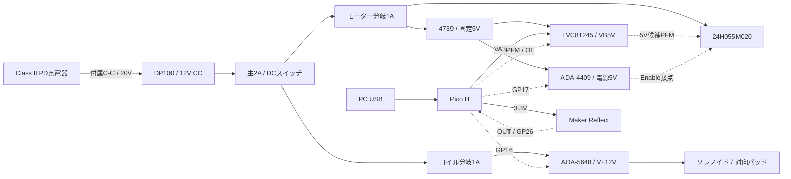

# 履歴: 用途違いの卓上R1機能ブロック

**この図は3軸姿勢制御用C08の機構/回路図ではありません。**
別体ソレノイドへ置き換えた旧案を履歴として残しています。[用途訂正の入口](../PROTOTYPE.md)。

**実線は電力、破線は信号の関係。GND・接点・抵抗を省略した機能図であり、実機検証済み配線図ではありません。**
具体的な端子・値は[信号設計](PROTOTYPE_SIGNAL.md)、摩擦機構は[機械図](PROTOTYPE_MECHANICAL.md)を参照します。

Pico VBUSは外部回路に接続しません。モーター側5Vはヒューズ後12Vから作ります。
リレーPHは5V、コイルPHは12Vで、ケーブル両端に区別するラベルを付けます。
GNDは共通基準ですが、モーター/コイルの帰路をPicoやブレッドボードへ通しません。
TLP291は不採用。内蔵ブレーキは比較に使わず、実物で解放状態を確認します。

モーター→継手→独立軸→円板という機械経路は、軸受2個と固定台で支えます。
電源断は瞬時停止ではなくパッドも解放され得るため、回転体・継手はカバー内へ置きます。
